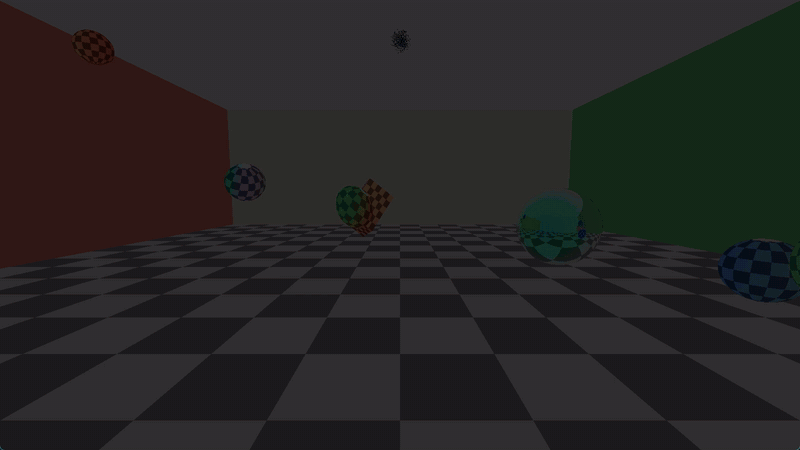

# rustman

A real-time GPU ray tracer where light travels at a slow, adjustable speed.



Light moves at 8 m/s by default, so what you see is delayed: every surface shows up where it *was* when the light left it. Moving objects lag behind and stretch, reflections show the past, and the scene ahead of you is older than the scene next to you. Push `c` up and you're back to normal rendering. Pull it down and things fall apart.

## How it works

- **Rays are null lines in spacetime.** A ray from the camera is traced backwards in both space and time: `x(s) = o + d·s`, `t(s) = t0 − s/c`. A hit is where the ray meets an object at the moment the light left it.
- **Objects are world tubes.** The CPU simulates spinning, orbiting and bouncing spheres and boxes at 60 Hz and keeps ~17 s of position and rotation history per object. The shader intersects rays with each object's state at the *retarded time*.
- **Occlusion comes for free.** The nearest hit along the ray is also the latest in time, so ordinary nearest-hit tracing gives the correct answer.
- **Chunked history.** History is split into 16-sample chunks with bounding spheres, so the shader skips whole time ranges a ray can't reach.
- **Doppler shift.** Light paths are color-shifted by the relative motion of source and receiver. Physically correct strength puts most of the shift outside visible light at `c = 8`, so the default is turned down to 0.25 and adjustable.
- Up to 4 bounces with mirrors, a moving lamp or a flashlight with shadows, plus an emission-time debug view that colors each pixel by how long ago its light was emitted.

Built with [wgpu](https://wgpu.rs) (one compute pass for tracing, one render pass to blit and draw the [egui](https://github.com/emilk/egui) overlay) and [winit](https://github.com/rust-windowing/winit). The tracer is a single WGSL shader, `shaders/trace.wgsl`, and it hot-reloads when you save it.

## Running

Needs a recent stable Rust toolchain (edition 2024) and a GPU with Vulkan, DirectX 12 or Metal.

```sh
cargo run --release
```

## Controls

| Key | Action |
| --- | --- |
| `W` `A` `S` `D` / `Q` `E` | Move / down, up |
| Right mouse | Look |
| `Up` / `Down` | Speed of light ×1.25 / ÷1.25 |
| `I` | Infinite `c` (compare against normal rendering) |
| `F` | Light on / off |
| `L` | Flashlight / ceiling lamp |
| `M` | Lamp circles / stays still |
| `V` | Doppler color on / off |
| `[` / `]` | Doppler strength ÷1.5 / ×1.5 |
| `T` | Emission-time debug view |
| `B` | Ambient light on / off |
| `R` | Half / full resolution |
| `Space` | Pause |
| `H` | Hide / show the control panel |
| `Esc` | Quit |

## License

[MIT](LICENSE)
